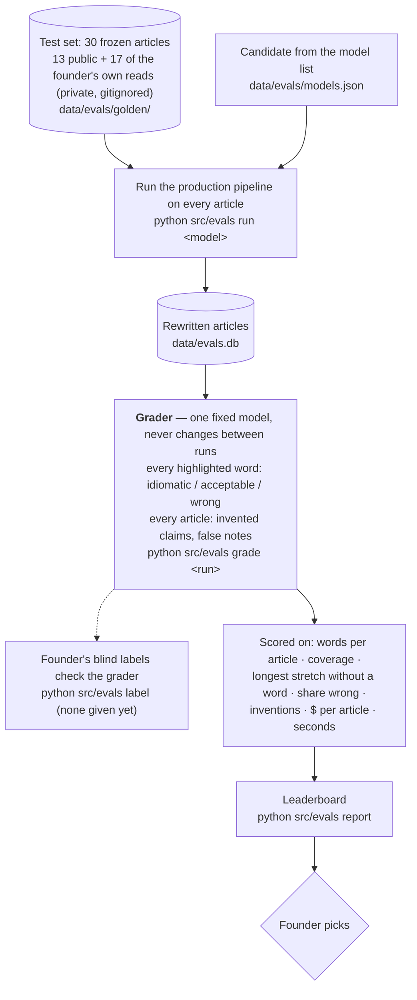

# Eval: article rewrite

**Tests:** the WRITER in [flow-share-an-article.md](flow-share-an-article.md) — by default the
whole pipeline (writer + both checkers + guard) with the candidate model in every role, so the
numbers mean "what if we switched". Runs while building, never on a user's request.
Record: `docs/model-bakeoff.md`. Current pick: Gemma 4 26B (PRD D42).

## Answer key

There is no fixed answer for "a good rewrite", so a **grader model** judges every output the same
way across months. How far to trust it is measured by the founder's blind labels; that check
hasn't been done yet, so grades are relative (model vs model), not absolute.

## When it runs

A new model is worth trying, or the writer's instructions change (a run on different engine code
doesn't compare — the leaderboard warns).
