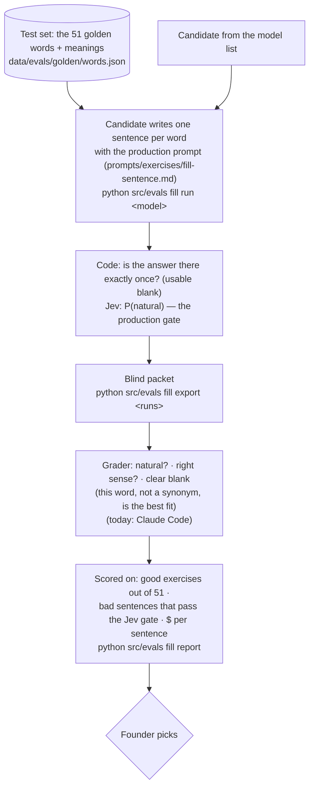

# Eval: fill-in sentence writer

**Tests:** the SENTENCE WRITER in [flow-fill-in-the-word.md](flow-fill-in-the-word.md), the model that
writes a fill-in sentence for a word with no sentence from your own reading. It runs while building,
never on a user's request. Required by PRD D55. Record: `docs/model-bakeoff.md` "Fill-in sentence writer".

## Answer key

A grader marks each exercise against the rubric (`RUBRIC` in `src/evals/fillin.py`). Today that's
Claude Code alone, so results are provisional.
