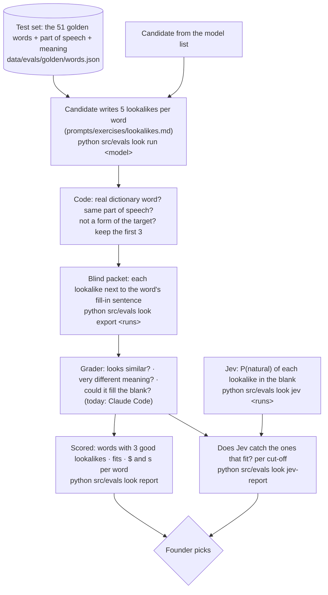

# Eval: lookalike writer (fill-in hint)

**Tests:** the LOOKALIKE WRITER for the fill-in hint (PRD D58): three words that look like the word but mean
something very different. Required by PRD D55. Record: `docs/model-bakeoff.md` "Lookalike writer".

