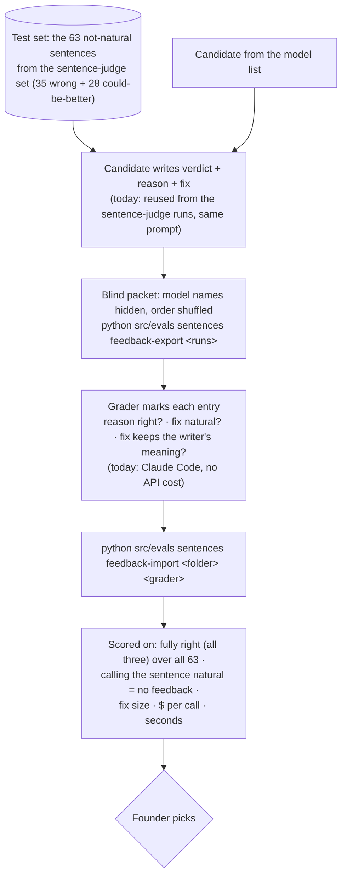

# Eval: sentence feedback writer

**Tests:** the FEEDBACK WRITER in [flow-write-a-sentence.md](flow-write-a-sentence.md): the reason and
smallest fix a model writes for a sentence that isn't natural. It runs while building, never on a
user's request. Required by PRD D55. Record: `docs/model-bakeoff.md` "Sentence feedback writer".

## Answer key

There is no single correct fix, so a grader judges each one against the rubric (`FEEDBACK_RUBRIC`
in `src/evals/sentences.py`). Today the grader is Claude Code, with one rater and n = 63, so the
results are provisional. A human grader, or a second rater, would firm them up.
