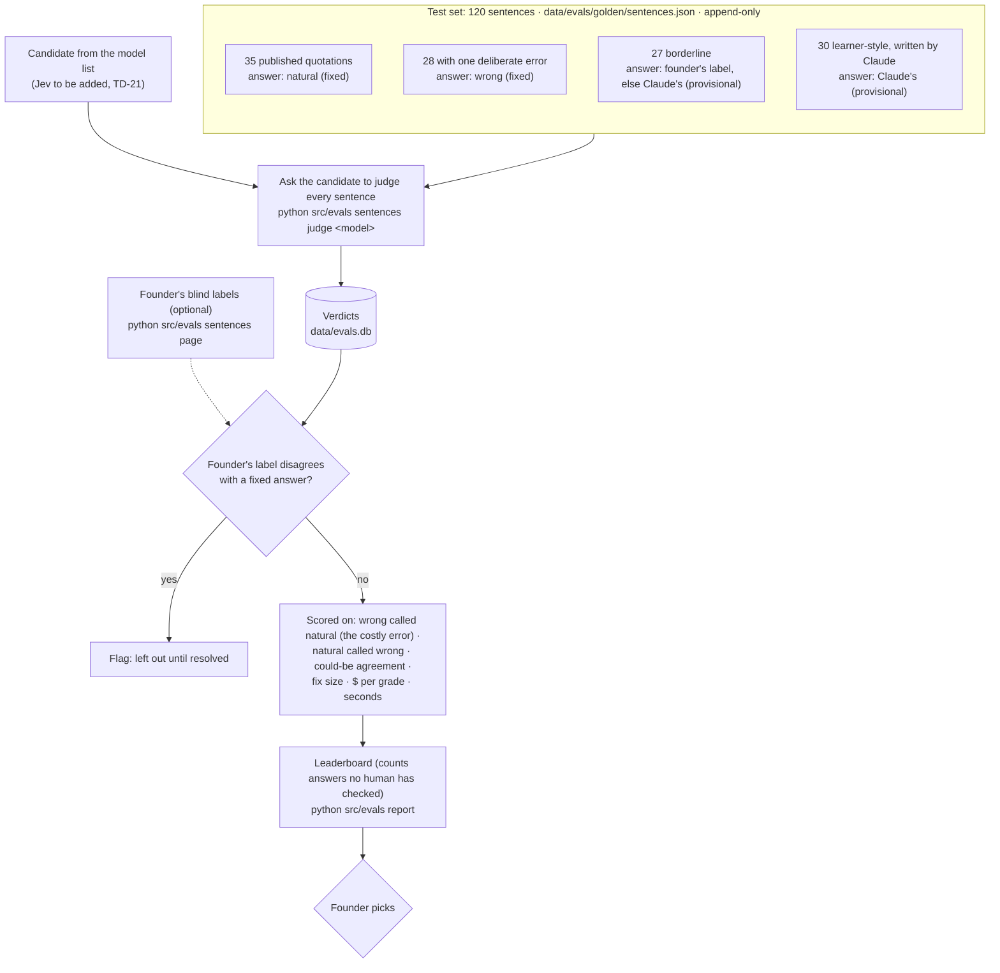

# Eval: sentence judge

**Tests:** the JUDGE in [flow-write-a-sentence.md](flow-write-a-sentence.md) — natural / could be
better / wrong for a sentence the user wrote with one of their words. Runs while building, never
on a user's request. Backlog TD-20 (built), TD-21 (Jev). Record: `docs/model-bakeoff.md`
"Sentence judge".

## Where it stands (2026-10-04)

6 models × 120 sentences, $0.68. Every model caught all 35 wrong sentences; they differ on the
in-between calls. 57 answers rest on Claude's labels alone, and on 16 sentences most models
disagree with them — a human look at those 16 comes before a pick. Cost decides as much as
accuracy while monetization is open (P2). The pushback column doesn't count: users can't argue
with a verdict (founder 2026-10-04).

## Answer key sources

Fixed by construction (published usage, a seeded error) · human (the founder's blind label) ·
provisional (Claude Code's label). The report states how many answers are provisional, so a
ranking built on Claude's own labels isn't mistaken for a settled one.
