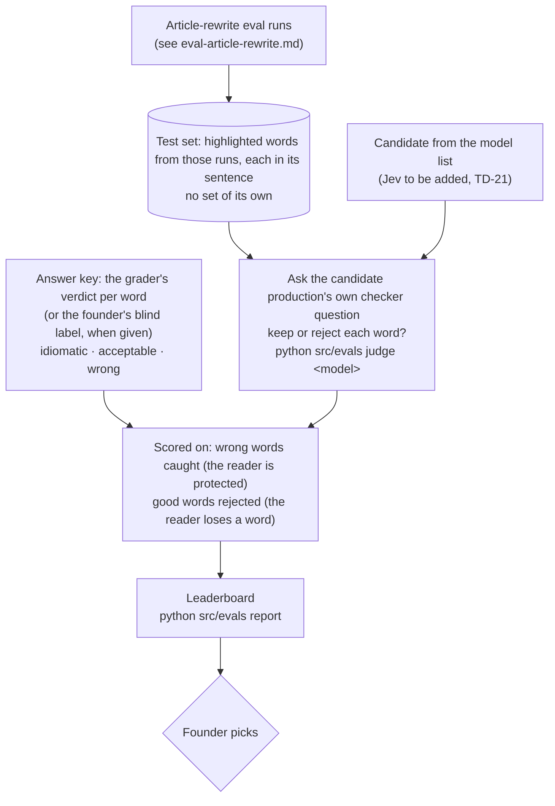

# Eval: word checker

**Tests:** the WORD CHECKER in [flow-share-an-article.md](flow-share-an-article.md) — the live
yes/no gate that rejects a highlighted word used unidiomatically. Runs while building, never on a
user's request. Jev is a candidate here (PRD D54, backlog TD-21).

## Results so far

Against the grader's verdicts (100 wrong, 116 idiomatic words): production's Gemma caught 55% of
wrong words and rejected 2 good ones; gpt-6-luna caught 91% but rejected 17 good ones. Why this
step has the most to gain from a better or cheaper checker.

## Answer key

Borrowed from the article-rewrite eval: the grader's per-word verdicts. If the grader is wrong,
this eval inherits the error — the founder's blind labels are the check (none given yet).
