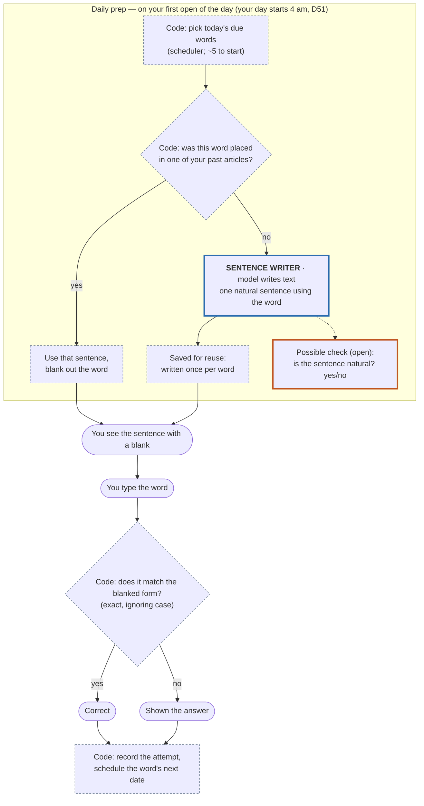

# User flow: fill in the word (daily exercise)

**Status: designed, not built** (PRD D53, backlog UX-16). Open details are marked below; this
drawing changes when UX-16 is designed with the founder.

**Legend:** blue = a model writes text · orange = a model answers yes/no · dashed grey = plain
code, no model.

**No model runs when you answer.** Models only appear in the prep, and only for words that have
no sentence from your own reading yet.

## Tested by

| Step | Eval |
|---|---|
| Sentence writer | none yet — needed before it ships |
| Possible naturalness check | none yet (yes/no, so Jev is a candidate, D54) |
| Answer check | none needed (code) |

## Open (decide in UX-16)

- **Word forms:** the blank may hold "bolstered" while the list says "bolster" — accept only the
  form in the sentence, or any form?
- Hints (first letter?), second tries, and what a miss does to the schedule.
- Whether prep runs on first open (D51) or ahead of time so it's instant.
