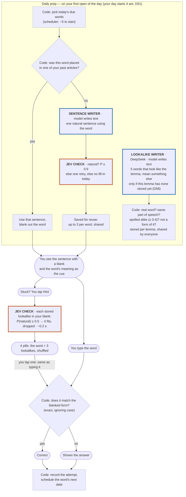

# User flow: fill in the word (daily exercise)

**Status: built 2026-10-04** (PRD D56; any order since D57: the user picks this exercise on the Practice chooser, and may skip it; backlog UX-16): `src/service/practice.py`, `ios/RetAIn/App/PracticeView.swift`.

**Legend:** blue = a model writes text · orange = a model answers yes/no · dashed grey = plain
code, no model.

**Hint (D58):** a hinted answer counts exactly like a typed one; the options shown are stored on the
attempt. **No model runs when you answer.** Models only appear in the prep, and only for words that have
no sentence from your own reading yet.

## Tested by

| Step | Eval |
|---|---|
| Sentence writer | [eval-fill-sentence.md](eval-fill-sentence.md) |
| Naturalness check (Jev) | [eval-sentence-judge.md](eval-sentence-judge.md) — same question as the sentence judge |
| Answer check | none needed (code) |

## Decided (D56)

- **Word forms:** the blanked form is right, and so is the base word (shown the form used).
- **One try**, then the answer; a miss sends the word back to tomorrow. No hints beyond the meaning.
- **Prep runs on the first open of the day** (1.6 s measured with four sentences to write).
