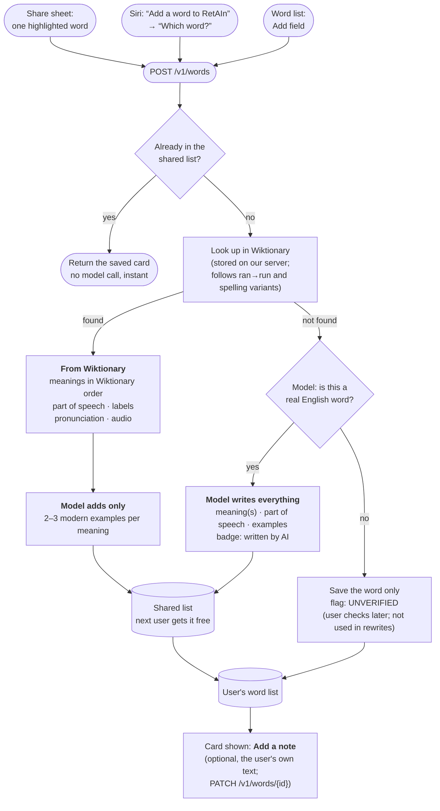

# User flow: save a word → its word card

Decisions: PRD D48 (2026-09-27); Siri entry point D50 (2026-09-28); the user's note D59 (2026-10-26). Research and spike numbers: `docs/content-sources.md`,
"Dictionary sources for word cards".

## Tested by

No eval yet. The model writes examples (text) and decides "is this a real English word?" (yes/no —
a Jev candidate, D54).

## Rules the diagram encodes

- **Dictionary for facts, model for examples.** Definitions and pronunciation come from
  Wiktionary whenever it has the word; the model never rewrites them. The model always writes
  the examples, because only 62% of the founder's 235 words have a modern Wiktionary example,
  usually on the literal sense.
- **Three ways in, one server call.** Share sheet, Siri and the word list's Add field all
  send the same request. The share sheet and Siri share one rule for what counts as a word
  (`WordInput.normalize`: one word, up to 40 letters, lowercased, punctuation stripped).
- **Siri's spelling check is the unverified flag.** A misheard word usually isn't in the
  dictionary, so Siri says "check the spelling" and shows what it saved.
- **At most one model call per new word, zero for a word already in the shared list.**
- **The note is the user's, and stays theirs.** It lives on their own word row, never on the
  shared card, and no model ever sees it. Saving the word again keeps it.
- **Unverified words stay private.** They never enter the shared list, so one user's typo
  cannot become everyone's entry.
- **Meaning order is Wiktionary's**, minus senses tagged archaic, obsolete, rare or dated.
  Picking the meaning the user intended (from the sentence it came from) is deferred.
