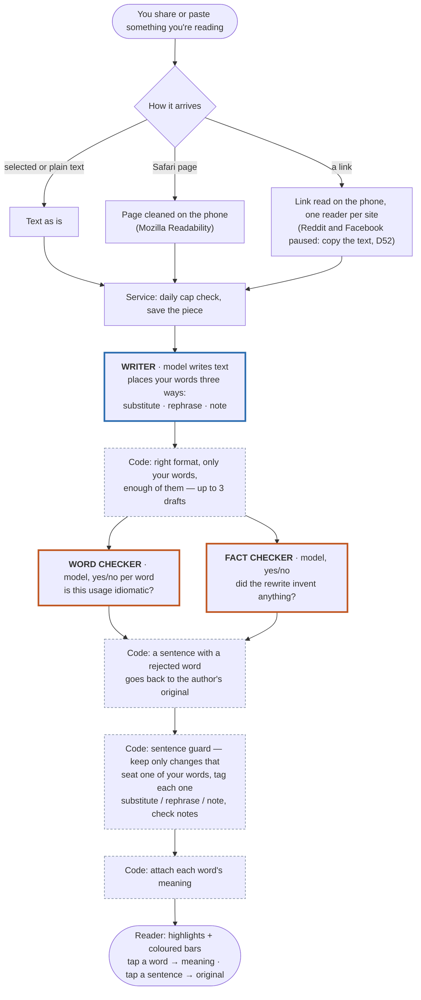

# User flow: share an article → read it with your words

Decisions: PRD D40 (three ways a word lands), D41 (a rejected word reverts its sentence, no re-run),
D19 (word checker on), D36 (fact checker), D44–D47 / D52 (how text arrives). Code:
`src/service/engine.py` → `src/generate.py` `generate_piece`. Status phases stream to the sheet
("generating", "checking").

**Legend:** blue = a model writes text · orange = a model answers yes/no (a quality gate, live on
every article) · dashed grey = plain code, no model.

## Tested by

| Step | Eval |
|---|---|
| Writer | [eval-article-rewrite.md](eval-article-rewrite.md) |
| Word checker | [eval-word-checker.md](eval-word-checker.md) |
| Fact checker | none yet (yes/no, so Jev is a candidate when built, D54) |

Every model call above goes through [infra-model-fallback.md](infra-model-fallback.md) (a slow or
failing host is raced by a backup model).

## Why

- **Two judges run live on every article.** They are not evals: they protect the reader in
  production. Evals are separate tests we run while building to choose the models that fill
  these boxes.
- **A rejected word costs no extra model call.** Its sentence returns to the author's original
  (D41); waiting beats a second draft.
- **Code decides the tier, not the model.** Substitute / rephrase / note is worked out from a
  word-level comparison with the source, so the reader's colours can be trusted.
