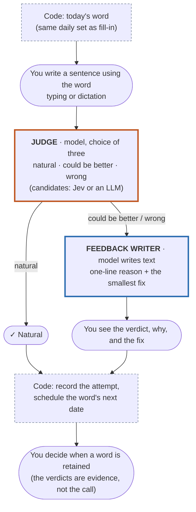

# User flow: write a sentence (daily exercise)

**Status: designed, not built** (PRD D53, backlog UX-16). Which model fills each box is being
measured now (TD-20, TD-21); the split below — a cheap decider, an LLM only when feedback is
needed — is the design under test, not yet decided.

**Legend:** blue = a model writes text · orange = a model chooses from fixed answers · dashed
grey = plain code, no model.

## Tested by

| Step | Eval |
|---|---|
| Judge | [eval-sentence-judge.md](eval-sentence-judge.md) |
| Feedback writer | measured inside the same eval today (one model returns verdict, reason and fix); its own eval comes if the split is chosen |

## Why

- **No arguing with a verdict** (founder 2026-10-04). The verdict is final in the UX, so the
  judge never sees a second, persuasive turn.
- **Feedback only where it teaches.** A natural sentence needs no explanation; paying an LLM to
  write one would multiply cost at 10K users for little learning.
- **Strict beats lenient.** A judge that calls a wrong sentence natural teaches the error, which
  the quality bar ranks worse than nothing.
