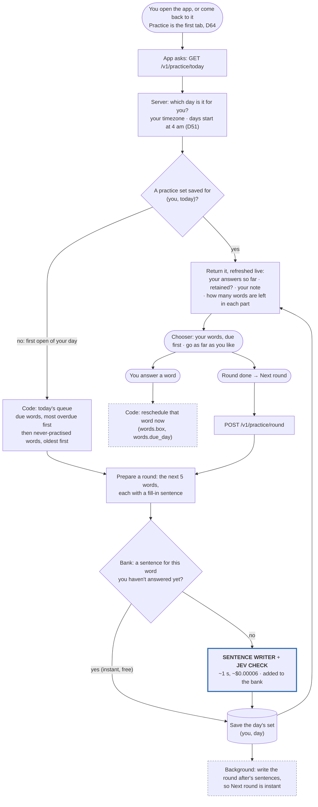
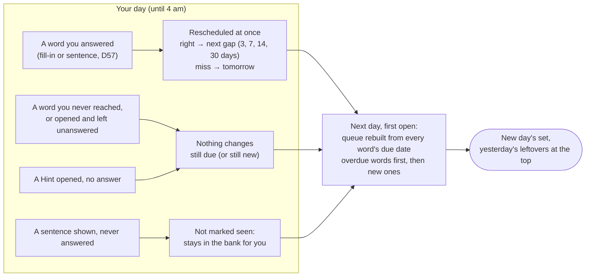

# A practice day: what starts it, and what carries over

Decisions: PRD D56 (daily practice), D57 (any order), D60 (rounds, sentence bank), D66 (one list, no limit), D72 (each exercise shuffles its round),
D51 (the user's day). Code: `src/service/practice.py`, `ios/RetAIn/App/PracticeView.swift`.

**The one idea to hold on to:** the schedule lives on each **word** (`words.box` = which gap it's on,
`words.due_day` = when it's next due). Today's practice set is only a record of what was prepared and
answered today. There is no queue table: every time, the queue is worked out fresh from the words'
due dates. So nothing needs to "carry over"; an unanswered word simply still has its old due date.

## 1. What starts it

- **Nothing runs overnight.** There is no scheduled job; the day's set is built the first time you
  open the app that day (built when asked for). A day you never open costs nothing.
- **Coming back to the app** (from the background) asks again; the same day returns the saved set,
  a new day (past 4 am) builds a new one.
- **The 7 pm reminder** is only a phone notification; it prepares nothing.
- **Order inside a round (D72):** each exercise visits the round's 5 words in its own shuffled order, fixed for the day (seeded by day, exercise and word), so one exercise doesn't give away the next word of another; rounds still come in priority order. The shuffle is worked out on the phone; the saved set keeps list order.

## 2. What carries over to the next day

- **Unpractised words come back by themselves**, at the front: they're the most overdue. Skipping
  several days just makes more words due; nothing is lost and there's no cap.
- **Partly done** counts per word, not per exercise: a word with only its fill-in done has already
  moved on the schedule (either exercise alone moves it, D57); its sentence exercise does not carry over.
- **Not-yet-due** words you didn't touch keep their future due date.
- Yesterday's saved set stays in the database as history (`practice_sets`); it isn't reused.
