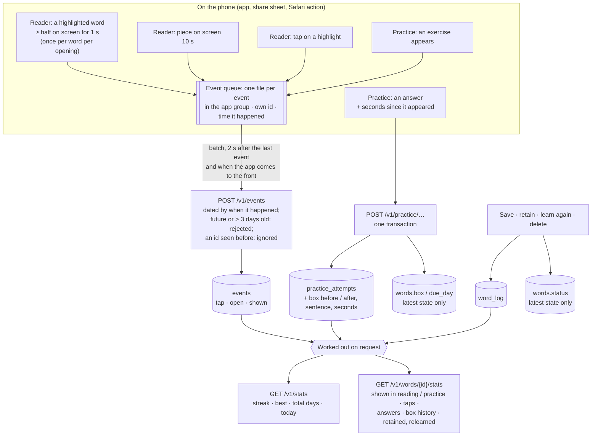

# Streaks and "shown": what gets recorded, and how stats come out of it

Decision: PRD D74 (2026-11-15). Research: `docs/streaks-stats-research.md`. Built 2026-11-15:
`src/service/stats.py`, `EventQueue.swift`, the reader's visibility script (`PieceHTML.swift`).

Two kinds of fact, stored as they happen and never changed; every stat is worked out from them when
asked for (no counters).

## Rules (D74)

- **A streak day** = a day (the user's day, D51) with a practice answer or a read (`open`). A missed day
  resets the streak; the total of days never resets. Later, a day saved with points becomes its own fact.
- **Shown** counts once per piece per day in the reader, once per exercise per day in practice; the raw
  events are all kept, so this rule can change without losing history. The Words list doesn't count.

## Why this shape (standard practice)

- **Append-only facts, derived stats:** Anki's review log vs its card table; a counter that one code path
  forgets to update is wrong forever, a query isn't.
- **Box before and after on each answer:** once `words.box` is overwritten, the past state is gone
  (Anki's `ivl`/`lastIvl`, FSRS review logs).
- **Phone-made ids, resends ignored:** the idempotency-key pattern; the queue can retry safely.
- **One file per event:** the app and its extensions add to the queue without editing a shared file
  (Apple TN2408: atomic writes for data shared with extensions).
- **Answer + schedule change in one transaction:** the log and the word row can't disagree.
