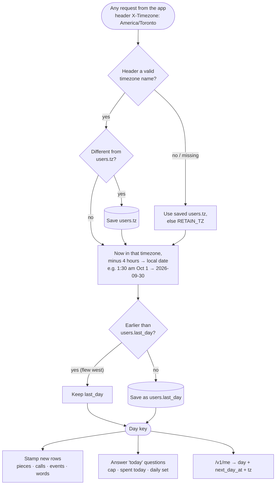

# The user's day: how every request knows what "today" is

Decision: PRD D51 (2026-09-30). Design: `docs/architecture.md` "The user's day".
Built 2026-09-30: `db.resolve_day` (server), `WordsStore.dayKey` (widget, same 4 am rule).

## Why

- UTC stays the stored truth; the day key is stored beside it so a later timezone change
  never rewrites history, and SQLite (which can't convert named timezones) can still group
  by day.
- 4 am, not midnight: late-night sessions stay in one day (Anki's default), and the boundary
  never falls in the hour daylight saving skips or repeats.
- The day never goes back: travel can't replay a day's cap or set.
