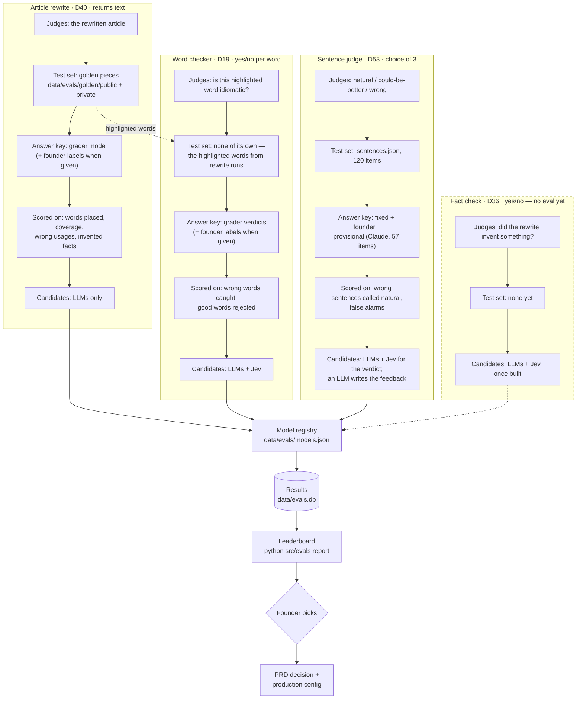

# Model evals: how a model earns a place in the app

Decisions: PRD D54 (2026-10-04: every yes/no, choice or score step is tested against Jev);
model changes go through `src/evals` first (CLAUDE.md). Harness: `src/evals/`; results
`data/evals.db` (gitignored); leaderboard `python src/evals report` → `output/evals/leaderboard.html`.

## The three eval families today

| Task | Returns | Command | Answer key | Headline metric |
|---|---|---|---|---|
| Rewrite engine (D40) | text | `run <model>` → `grade <run>` | grader model (+ founder labels when given) | words placed, coverage, wrong usages, inventions |
| Word checker (D19) | yes/no per word | `judge <model>` | grader verdicts / founder labels | share of wrong words caught |
| Sentence judge (D53, TD-20) | choice: natural / could-be-better / wrong | `sentences judge <model>` | fixed + provisional (57 of 120 Claude's) | wrong sentences called natural |

Jev candidates are not wired in yet (next step after the founder adds `TYPESAFE_API_KEY`).
Fact check (D36) is yes/no too and has no eval yet.

## Why

- **Four separate evals, shared machinery.** Each eval has its own question, test set, answer key
  and success measure; they share only the model list, the results store, the leaderboard and the
  founder's pick. The word checker is the one exception to "own test set": it re-judges the
  highlighted words that rewrite runs produced.
- **The answer key is labelled by source, in every eval.** Fixed by construction (published usage,
  a seeded error), human (the founder's blind label), provisional (Claude Code's label, counted in
  the report until a human checks) or a grader model. Where a human label disagrees with a fixed
  answer, the item is flagged and left out until resolved. The report says how many answers no
  human has checked, so a ranking built on Claude's own labels is never mistaken for a settled one.
- **One set, many models.** A model is only compared with others on the same frozen set
  and the same prompt version; anything else isn't a comparison.
- **Cost and speed sit beside quality.** With monetization undecided (P2), $ per call at
  10K users decides as much as accuracy. That's why yes/no, choice and score steps always
  get a Jev run: about $0.00002 per call, ~100 ms per TypeSafe's docs.
- **Jev can't write.** Where a step needs an explanation or a fix, Jev can decide and an
  LLM explains, and only on the cases that need it.
- **Pushback isn't tested for exercises.** Users can't argue with a verdict in the UX
  (founder 2026-10-04), so the harness's pushback-flip column doesn't count toward a pick.
